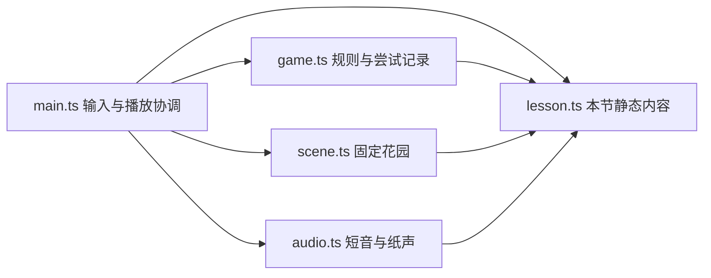

# 三音学习单元最小实现约定

## Design Paradigm

沿用纯规则核心与副作用外层：`game.ts`决定发生什么，`main.ts`把状态转换成纸面UI、场景与声音。只新增本节内容文件`lesson.ts`，不引入框架或通用课程引擎。本约定只约束这一个单元，不冻结整个产品架构。

## Invariants & Rules

### AD-1 — 同一声音只有一个内部标识

- **Binds:** CAP-1至CAP-4；所有模块。
- **Prevents:** 切换唱名后声音、画面和判题各用一套对应规则。
- **Rule:** `lesson.ts`唯一声明`MaterialId = 'C' | 'D' | 'E'`及本节音名、唱名、频率与固定任务。其余模块引用，不另建映射。任务提示与按钮可切换`letter`/`solfege`标记，但槽位和答案始终保存MaterialId。本节只解释C大调中的对应，不定义跨调规则。

### AD-2 — 规则与证据只有一个写入者 [ADOPTED]

- **Binds:** CAP-2至CAP-4；所有Story。
- **Prevents:** UI提前通关、渲染器判题、重试覆盖首答。
- **Rule:** 延续`createGame/act`，由纯规则模块拥有阶段、当前任务、槽位、提交快照和逐题记录；UI只能派发Action。空槽不算有效提交；有效提交后不可编辑播放快照或重复计数；错误后保留组合可修正。首次提交及其是否求助不可改写；正确提交被接受时即封存该题完成方式，播放期间或之后回看不追改。记录completed表示判题完成，不能代替播放完成门槛。完整单元只在全部挑战通过且最后提交播放完成后进入开桥/过桥阶段。详细状态约定见`implementation.md`。

### AD-3 — 播放与显示是同一次提交的投影

- **Binds:** CAP-1至CAP-4；main、scene、audio。
- **Prevents:** 重复音错位、旧回调推动新题、静音卡住、3D标签泄露答案。
- **Rule:** main只维护一条播放队列，以槽位索引同步声音和动效；结束事件携带`run/taskId/submissionId`，规则仅接受当前匹配且未暂停的事件。暂停取消旧播放并保留提交，继续后从该提交开头重播，不增加提交次数。静音沿用同一视觉时间线；减少动效不跳过音符。DOM文字、可访问名称、3D纹理按同一labelMode更新，材料无固定专属颜色；选中/发声高亮只标状态，不提供对应关系。

### AD-4 — 当前页内完成一个单元 [ADOPTED]

- **Binds:** 全部范围、运行环境与恢复。
- **Prevents:** 单元开发扩成内容平台，或把内存进度说成持久存档。
- **Rule:** 继续使用现有单前端、固定镜头和本地预览，无新增运行依赖或依赖升级。题目与本轮记录只保存在当前页内存；旋转/后台保留，刷新或系统回收后重新开始并明确提示此边界。复玩建立新run，可保留当前页最近一轮只读摘要，不累计历史。声音解锁失败可无声继续；WebGL失败保留现有重载入口。

## Structural Seed

只新增`app/src/lesson.ts`。扩展现有`game.ts`、`main.ts`、`scene.ts`、`audio.ts`及`style.css`；`art.ts`扩展现有faceTexture标签类型及唱名/双标签排版，复用绘字能力。不拆资源服务、事件总线、存储层或题目注册器。

现有`app/package.json`与锁文件继续拥有依赖版本：Three.js 0.186.1、TypeScript 7.0.2、Vite 8.3.4、Playwright 1.64.1（2026-10-30读取；不是升级建议）。浏览器是运行环境；WebGL 2与Web Audio实际能力分别检测。核对：[Three.js WebGLRenderer](https://threejs.org/docs/pages/WebGLRenderer.html)、[MDN AudioContext.resume](https://developer.mozilla.org/en-US/docs/Web/API/AudioContext/resume)。这不替代iPhone真机验证。

本地构建沿用`app/dist`，预览沿用8877；浏览器验证须确认实际加载本次构建。公网托管、证书、账号与远程服务不属于本轮。

## Capability → Architecture Map

| 能力 | 落点 | 约定 |
| --- | --- | --- |
| CAP-1 介绍与同音双标记 | lesson/main/scene/audio | AD-1、AD-3 |
| CAP-2 引导练习 | lesson/game/main | AD-1、AD-2 |
| CAP-3 双向与组合应用 | game/main/scene/audio | AD-1至AD-3 |
| CAP-4 回听复玩与记录 | game/main/audio | AD-2至AD-4 |

## Deferred

- 跨调唱名体系：进入跨调内容前决定，本节限定语境不依赖该选择。
- 正式产品框架、原生包装和长期内容架构：多个真实单元出现重复需求后再判断，不把本节结构推成平台标准。
- 跨刷新存档、离线、部署环境与运维：本轮当前页体验不依赖；需可分享或长期使用时独立确定。
- 外部素材管线与新场景：沿用已有手绘花园，本轮只有标签/槽位/局部机关反馈调整。
